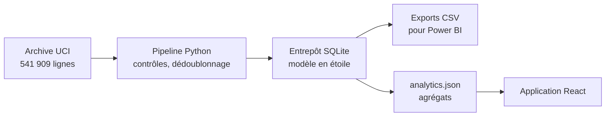

<p align="center">
  
</p>

<h1 align="center">RetailScope</h1>

<p align="center">
  Les ventes, les avoirs et la fidélité des clients d'un commerce en ligne britannique,<br>
  à partir de 541 909 lignes de transactions réelles.
</p>

<p align="center">
  <a href="https://badreddine05.github.io/retailscope/"><strong>Ouvrir l'application</strong></a>
  &nbsp;·&nbsp;
  <a href="https://badreddine05.github.io/projets/retailscope/">Lire l'étude de cas</a>
  &nbsp;·&nbsp;
  <a href="docs/METHODOLOGY.md">Méthodologie</a>
</p>

<picture>
  <source media="(prefers-color-scheme: dark)" srcset=".github/readme/retailscope-dark.png">
  
</picture>

## Le projet

Le jeu UCI Online Retail rassemble les factures d'un commerçant en ligne britannique entre décembre 2010 et décembre 2011. Il vend surtout des articles cadeaux, souvent à des grossistes. RetailScope fait avec ce fichier ce qu'une équipe BI ferait : un pipeline qu'on peut relancer, un entrepôt SQLite en étoile, des indicateurs définis sans ambiguïté et un tableau de bord qui s'ouvre dans le navigateur.

## Ce que l'on peut faire

Les filtres de pays et de période s'appliquent à toutes les vues et aux exports.

- Vue d'ensemble : chiffre d'affaires net, commandes, panier moyen, part des avoirs, évolution mensuelle et principaux marchés. Cliquer sur un pays le sélectionne.
- Clients et fidélisation : segments RFM aux règles explicites, meilleurs clients et cohortes mensuelles, où les mois encore impossibles à observer restent vides.
- Catalogue : recherche par référence ou description, tri, pagination et export CSV.
- Données et méthode : contrôles de qualité, règles de calcul, source, licence et empreinte du fichier.

Il n'y a ni compte, ni clé d'API, ni service payant.

## Ce que montrent les données

- Sur les douze mois complets, le chiffre d'affaires net atteint 9,32 millions de livres pour 19 141 commandes. Le panier moyen, 523 livres, reflète le poids des grossistes.
- Les ventes montent nettement à partir de septembre, jusqu'à 1,46 million de livres en novembre 2011.
- Le Royaume-Uni représente 84 % des ventes nettes. Les avoirs pèsent 6,9 % des ventes brutes.
- Les clients classés « Champions » sont 20 % des clients identifiés et réalisent 69 % de leurs achats.

## Comment ça marche



Le pipeline retire 5 268 doublons exacts et 2 512 lignes à prix nul ou négatif. Les avoirs restent dans les données, comptés à part, pour calculer un chiffre d'affaires net. Les montants sont stockés en millièmes de livre, sous forme d'entiers, et les tests vérifient qu'ils se réconcilient exactement d'une étape à l'autre.

## Essayer en local

Avec Node.js 22.12 ou plus récent :

```sh
npm ci
npm run dev
```

Les agrégats sont inclus. Pour reconstruire l'entrepôt depuis la source, lancer les tests ou construire l'image Docker, voir [docs/DEVELOPMENT.md](docs/DEVELOPMENT.md). Le [guide Power BI](docs/POWER_BI.md) explique comment refaire le tableau de bord dans Power BI à partir des exports.

## Limites

- Un seul commerçant, en 2010 et 2011, avec beaucoup de grossistes. La source ne contient ni coûts, ni stocks, ni marges.
- Les avoirs ne sont pas reliés à leur facture d'achat : leur part n'est pas un taux de retour produit.
- Le premier achat observé n'est pas forcément le premier achat réel, surtout pour les clients de décembre 2010.
- Les segments RFM reposent sur des seuils lisibles. Ils décrivent la clientèle à une date donnée et ne prédisent rien.

## Sources et crédits

Données : Chen, D. (2015). *Online Retail*. UCI Machine Learning Repository. [doi:10.24432/C5BW33](https://archive.ics.uci.edu/dataset/352/online+retail), sous licence [CC BY 4.0](https://creativecommons.org/licenses/by/4.0/) ; les agrégats publiés en sont une adaptation documentée. Ce projet n'est pas une prestation pour l'entreprise du jeu de données.

Code sous licence [MIT](LICENSE). Polices Newsreader, IBM Plex Sans et IBM Plex Mono (SIL OFL 1.1) ; licences de React, Recharts et Lucide : voir [THIRD_PARTY.md](THIRD_PARTY.md).

Projet personnel de [Badreddine Channoufi](https://badreddine05.github.io/), réalisé avec l'aide d'outils d'IA. Les commits portent leurs dates réelles.

<details>
<summary>English summary</summary>

RetailScope turns the UCI Online Retail transactions of a UK online retailer (December 2010 to December 2011) into a SQLite star schema and a browser dashboard: net sales, credit notes, RFM segments, monthly cohorts and a searchable catalogue. Tests check that amounts reconcile exactly and that filters stay consistent across views.

</details>
