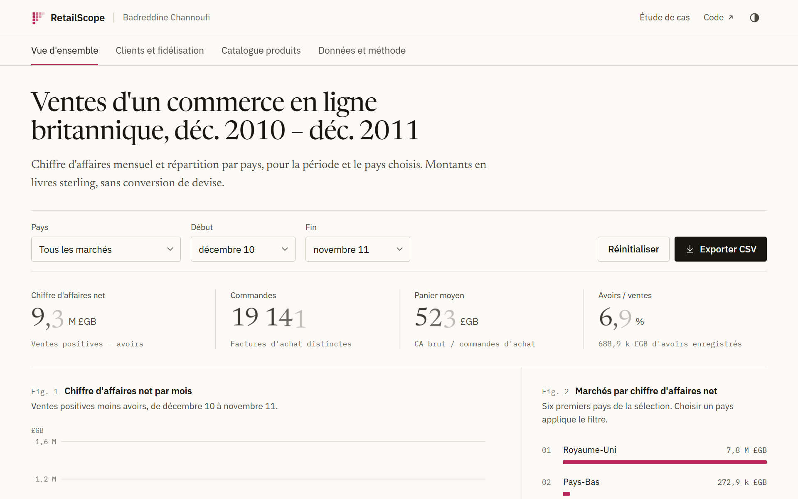

<picture>
  <source media="(prefers-color-scheme: dark)" srcset=".github/readme/retailscope-dark.png">
  
</picture>

# RetailScope

Un tableau de bord BI sur les transactions réelles d'un commerce en ligne britannique (jeu UCI Online Retail, décembre 2010 à décembre 2011) : ventes, avoirs, segments de clients et cohortes de fidélité.

**[Ouvrir l'application](https://badreddine05.github.io/retailscope/)** · [Lire l'étude de cas](https://badreddine05.github.io/projets/retailscope/) · [Méthodologie](docs/METHODOLOGY.md)

## Ce que l'on peut faire

L'application s'ouvre dans le navigateur, sans compte, clé d'API ni service payant. Les filtres de pays et de période s'appliquent à toutes les vues et aux exports.

- Vue d'ensemble : chiffre d'affaires net, commandes, panier moyen, part des avoirs, évolution mensuelle et principaux marchés. Cliquer sur un pays le sélectionne.
- Clients et fidélisation : segments RFM aux règles explicites, meilleurs clients et cohortes mensuelles, où les mois encore impossibles à observer restent vides.
- Catalogue : recherche par référence ou description, tri, pagination et export CSV.
- Données et méthode : contrôles de qualité, règles de calcul, source, licence et empreinte du fichier téléchargé.

## Ce que montrent les données

- Sur les douze mois complets, le chiffre d'affaires net atteint 9,32 millions de livres pour 19 141 commandes, avec un panier moyen de 523 livres, qui reflète le poids des grossistes.
- Les ventes montent nettement à partir de septembre, jusqu'à 1,46 million de livres en novembre 2011.
- Le Royaume-Uni représente 84 % des ventes nettes. Les avoirs pèsent 6,9 % des ventes brutes.
- Les clients classés « Champions » sont 20 % des clients identifiés et réalisent 69 % de leurs achats.

## Lancer le projet

Il faut Node.js 22.12 ou plus récent. Les agrégats sont déjà dans le dépôt.

```sh
npm ci
npm run dev
```

Ouvrez l'adresse affichée par Vite. Pour la version de production :

```sh
npm test
npm run build
npm run preview
```

`dist/` est un site statique, utilisable sous un sous-chemin (`base: './'`). Aucune requête ne part vers une API pendant l'exploration. Une image Docker sert le site avec Nginx :

```sh
docker build -t retailscope .
docker run --rm -p 8080:80 retailscope
```

## Reconstruire les données

Le pipeline lit le fichier XLSX officiel avec la seule bibliothèque standard de Python 3.11 ou plus récent. Le premier lancement télécharge l'archive UCI (environ 23 Mo) ; les suivants la réutilisent après avoir vérifié son SHA-256.

```sh
python pipeline/build.py
python -m unittest discover -s tests -p "test_*.py"
npm test
```

| Sortie | Usage |
| --- | --- |
| `data/raw/online-retail.zip` | Archive source, non versionnée |
| `data/warehouse/retailscope.sqlite` | Modèle en étoile, non versionné |
| `data/warehouse/exports/*.csv` | Tables complètes pour Power BI, non versionnées |
| `public/data/analytics.json` | Agrégats et factures d'achat pseudonymisées pour l'application |
| `public/data/manifest.json` | Provenance, empreintes, comptages et schéma |

Les montants sont calculés en millièmes de livre, sous forme d'entiers, pour garder exacts les quelques prix à trois décimales de la source. Les lignes sans identifiant client restent dans les totaux commerciaux et sortent des analyses par client.

| Contrôle | Résultat |
| --- | ---: |
| Lignes de la source | 541 909 |
| Doublons exacts retirés | 5 268 |
| Lignes à prix nul ou négatif exclues | 2 512 |
| Lignes retenues | 534 129 |
| dont sans identifiant client | 132 565 |
| Factures d'achat distinctes | 19 960 |

## Pour les développeurs

| Chemin | Rôle |
| --- | --- |
| `pipeline/build.py` | Lecture du XLSX, contrôles, dédoublonnage, entrepôt SQLite et agrégats |
| `sql/` | Schéma en étoile (`fact_line`, dimensions date, pays, produit, client) et mesures |
| `src/analytics.js` | Filtres, indicateurs, RFM et cohortes |
| `src/main.jsx`, `src/style.css` | Interface React et graphiques Recharts |
| `tests/` | Réconciliation des montants, filtres, RFM, cohortes, échappement CSV |
| `docs/` | [Méthodologie](docs/METHODOLOGY.md) et [guide Power BI](docs/POWER_BI.md) |

Après une reconstruction, `sql/measures.sql` vérifie l'entrepôt : `PRAGMA foreign_key_check` ne doit renvoyer aucune ligne. Le guide Power BI décrit les exports et les mesures DAX pour reconstruire le rapport ; aucun fichier `.pbix` n'est livré.

## Limites

- Un seul commerçant, en 2010 et 2011, avec beaucoup de grossistes. La source ne contient ni coûts, ni stocks, ni marges.
- Les avoirs ne sont pas reliés à leur facture d'achat : leur part n'est pas un taux de retour produit.
- Le premier achat observé n'est pas forcément le premier achat réel, surtout pour la cohorte de décembre 2010.
- Les segments RFM reposent sur des seuils lisibles. Ils décrivent la clientèle et ne prédisent rien.

## Données, licences et crédits

Données : Chen, D. (2015). *Online Retail*. UCI Machine Learning Repository. [doi:10.24432/C5BW33](https://archive.ics.uci.edu/dataset/352/online+retail), sous licence [CC BY 4.0](https://creativecommons.org/licenses/by/4.0/) ; les agrégats publiés en sont une adaptation documentée. Ce projet n'est pas une prestation pour l'entreprise du jeu de données.

Code sous licence [MIT](LICENSE). Polices Newsreader, IBM Plex Sans et IBM Plex Mono sous SIL OFL 1.1 ; licences de React, Recharts et Lucide : voir [THIRD_PARTY.md](THIRD_PARTY.md).

Projet personnel de [Badreddine Channoufi](https://badreddine05.github.io/), réalisé avec l'aide d'outils d'IA. Les commits portent leurs dates réelles.

## In English

RetailScope turns the UCI Online Retail transactions (a UK online retailer, December 2010 to December 2011) into a SQLite star schema and a browser dashboard: net sales, credit notes, RFM segments, monthly cohorts and a searchable catalogue. Tests check that amounts reconcile exactly and that filters stay consistent across views.
